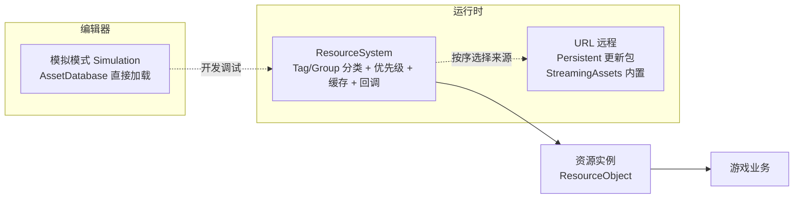

# GGResource (内测版)

基于 Loxodon Framework 的 Unity 资源管理模块，提供 AssetBundle / Simulation 双路径、异步加载、优先级、缓存和引用计数。

[](https://github.com/gonglei007/GGFramework-GGResource/blob/main/GGResource/ProjectSettings/ProjectVersion.txt) [](https://github.com/gonglei007/GGFramework-Core/tree/v0.1.1) [](https://github.com/gonglei007/GGFramework-GGResource/tree/main)

## 项目导航

[Demo 体验](https://github.com/gonglei007/GGFramework-Demo) · [架构文档](https://github.com/gonglei007/GGFramework-Docs) · [Core](https://github.com/gonglei007/GGFramework-Core) · **GGResource** · [GGNetwork](https://github.com/gonglei007/GGFramework-GGNetwork) · [GGUI](https://github.com/gonglei007/GGFramework-GGUI) · [GGUser](https://github.com/gonglei007/GGFramework-GGUser)

> **先体验整体框架**：[打开独立 Demo](https://github.com/gonglei007/GGFramework-Demo#快速开始)，体验资源、HTTP、UI、用户 SDK 与 Lua 的集成流程。[操作指南](https://github.com/gonglei007/GGFramework-Demo/blob/main/documents/showcase-guide.md) · [验收记录](https://github.com/gonglei007/GGFramework-Demo/blob/main/documents/showcase-verification.md)。

## 模块关系

本工程通过 UPM 固定使用 **Core v0.1.1**，资源后端由工程内 Loxodon Framework 等依赖提供。GGUI 和 Demo 保留了资源实现的源码副本；这里的修复需要显式同步到消费工程。

完整依赖图、工程锁定版本和源码副本边界由[架构文档中心](https://github.com/gonglei007/GGFramework-Docs#模块关系)统一维护。

## 快速开始

在准备存放代码的目录运行：

```powershell
git clone https://github.com/gonglei007/GGFramework-GGResource.git
# 在 Unity Hub 中打开 GGFramework-GGResource/GGResource
```

1. 用 Unity **6000.3.13f1** 打开 `GGResource` 工程，等待包解析完成。
2. 从[集成 Demo 的资源页](https://github.com/gonglei007/GGFramework-Demo/blob/main/documents/showcase-guide.md)体验本地加载、缓存引用、Simulation 和真实 Bundle；本模块的 [Demo.unity](GGResource/Assets/Demo/Demo.unity) 为场景参考。
3. 在自己的工程中按[快速接入指南](documents/quickstart.md)复制框架与依赖，保留 manifest 中的 Core 固定引用。
4. 为测试资产设置 AssetBundle 名称；编辑器可用 `Loxodon::Framework::Bundle::SimulateInEditor` 菜单切换模拟模式，运行时先准备 Bundle 与清单。
5. 准备好资源后调用 `ResourceSystem.Instance.Init("Game")`，再按资产清单使用 `AddResourceItem` / `StartLoading`。具体路径格式、回调与清理方式见[技术手册](documents/manual.md)。

## 简介

GGResource 是一个面向游戏客户端的**资源管理系统**，基于 Loxodon Framework 的 AssetBundle 体系构建。它提供按分组 / 标签分类、优先级排序、异步加载队列、缓存与状态回调，并支持编辑器模拟模式，让资源加载更方便、可控、可调试。

### 架构示意



> **双路径**：编辑器用模拟模式（不打 Bundle 即可跑通），运行时走 AssetBundle；`GBundleBuilder` 按 `缓存 → Persistent → StreamingAssets → URL` 顺序选择来源，支持加密 Bundle。

## 功能与特性

**多来源加载**

- 加载来源按 **Persistent → StreamingAssets → 网络 URL** 的顺序选择，支持远程热更资源
- 运行时 AssetBundle 与编辑器模拟（Simulation）双路径统一封装

**分类与优先级加载**

- 资源按 **Tag**（UI / Model / VFX / Other）与 **Group** 分类管理
- 支持加载优先级排序与队列插队，保证关键资源优先加载
- 提供加载进度（已加载 / 总数）与就绪状态回调

**异步加载与事件回调**

- 异步加载资产，支持随时加载的独立 Bundle（float 资源）
- 回调体系：`onHighResourceLoaded`（高优先级完成）、`onResourceLoaded`（单个完成）、`onAllResourceLoaded`（全部完成）
- `ListenObject` 监听对象资源就绪

**缓存与去重**

- 按 `group-tag` 分桶的资源缓存表，加载去重与依赖记录

**加密与平台兼容**

- 预置 `IStreamDecryptor` 与 Loxodon `CryptographBundleLoader` 对接，支持**加密 Bundle**
- WebGL 分支、Android 文件读取、`UNITY_EDITOR` 条件编译

## 工程内容

<table>
    <tr><th>目录</th><th>内容</th><th>说明</th></tr>
    <tr>
        <td>GGResource/Assets/Scripts/GGResource</td>
        <td>框架代码</td>
        <td>可以直接复制到目标工程中使用。</td>
    </tr>
    <tr>
        <td>GGResource/Assets/Demo</td>
        <td>演示工程</td>
        <td>演示场景与资源加载参考。</td>
    </tr>
</table>

## 核心模块

| 模块 | 说明 |
| ---- | ---- |
| `Systems/ResourceSystem` | 核心资源管理系统（单例）：加载队列、优先级、缓存、回调 |
| `Resource/GBundleBuilder` | Bundle 加载器工厂：按缓存 / 路径 / 网络选择载体，支持加密 |
| `Resource/GMappingPathInfoParser` | 运行时路径 ↔ Bundle 映射解析器 |
| `Resource/GSimulationAutoMappingPathInfoParser` | 编辑器模拟模式解析器（不打 Bundle 即可调试） |
| `Resource/ResourceItem` / `ResourceObject` | 加载任务描述与结果缓存对象 |

## 依赖

* **GGFramework.Core** — `Singleton` / `CoroutineUtil` 等基础类的单一源，经 UPM git URL 引用（`#v0.1.1`）；工程内原本地 `Singleton.cs` 副本已删除
* **Loxodon Framework** — 底层 AssetBundle 加载 / 协程 / 加密（位于 `Assets/LocalPackages`）
* **CsAsync** — 异步任务流库（`Waterfall` / `Whilst` / `Each`），用于串联加载队列（位于 `Assets/LocalPackages`）
* **SimpleJson** — 轻量 JSON 序列化库

## 设计模式

* **单例** — `ResourceSystem : Singleton<ResourceSystem>`（`Singleton<T>` 由 `GGFramework.Core` 提供）
* **工厂方法** — `GBundleBuilder` 按条件返回对应加载器
* **策略 / 接口分离** — `IPathInfoParser`（运行 / 模拟两套实现）、`ILoaderBuilder`、`IResources`
* **观察者 / 回调** — 加载回调事件、`ListenObject` 资源就绪监听
* **控制反转（IoC）** — 通过 Loxodon 容器注册 `IResources` 服务

## 注意

* 当前 `Group` 固定为 "all" 统一管理；`Retain` / `DestroyObject` 支持引用计数，`ClearObjects` 用于显式清理，按业务组隔离仍需进一步完善
* 核心源码注释较少，部分旧实现（队列 / Lua 回调）保留在注释中，可为后续演进作参考

## 文档

* [如何快速接入?](documents/quickstart.md)
* [技术手册](documents/manual.md)

## 进群沟通

| | | |
| --- | -------- | -------- |
| QQ群: | 242500383 | [](https://qm.qq.com/cgi-bin/qm/qr?k=fy4Z65nE-5Jd1ay8FkJpDc9iPJyW3d38&jump_from=webapi) |

## TODO-List

* 按业务组隔离的资源管理（当前 `Group` 统一为 `all`）
* 更完整的 Demo 演示

## 更多资料

* [游戏开发图谱](https://github.com/gonglei007/GameDevMind)

## 自动化 Unity 回归与 CI

本仓契约：[ci/unity-regression.json](ci/unity-regression.json)。EditMode 至少 15 项、PlayMode 至少 2 项。新 PlayMode 检查最后引用释放后的原生对象销毁，以及显式独占组清理后的缓存/原生对象释放；不初始化 Loxodon 或宣称全量内存无泄漏。

共享执行器按 [Demo `6fba3a3`](https://github.com/gonglei007/GGFramework-Demo/tree/6fba3a32aae1951df8dd034dd15f36a36ab25895/tools/ci) 固定复用，保持本模块运行时依赖不变。[本地命令、一次性 Windows runner、触发规则、artifact 与边界](https://github.com/gonglei007/GGFramework-Demo/blob/6fba3a32aae1951df8dd034dd15f36a36ab25895/tools/ci/README.md)统一维护。分支 push 会排队真实 Unity job，PR 托管契约检查不能代替 Unity；没有 runner 时不会计为 Unity 通过。每轮结束后注销 runner，不安装服务、不上传 Unity 授权。
