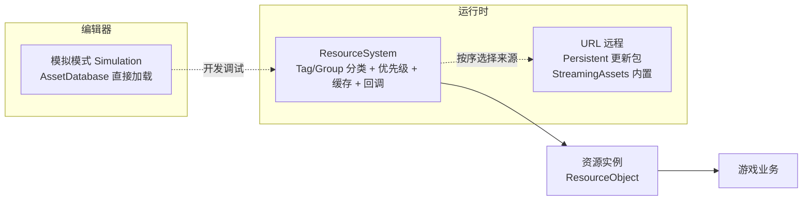

  <h1 align="center">GGResource (内测版)</h1>
  

    
    
    
    
  

  
一个基于 AssetBundle 的游戏客户端资源管理系统

## 简介

GGResource 是一个面向游戏客户端的**资源管理系统**，基于 Loxodon Framework 的 AssetBundle 体系构建。它提供按分组 / 标签分类、优先级排序、异步加载队列、缓存与状态回调，并支持编辑器模拟模式，让资源加载更方便、可控、可调试。

### 架构示意

> **双路径**：编辑器用模拟模式（不打 Bundle 即可跑通），运行时走 AssetBundle；`GBundleBuilder` 按 `缓存 → Persistent → StreamingAssets → URL` 顺序选择来源，支持加密 Bundle。

## 功能与特性

**多来源加载**

- 加载来源按 **Persistent → StreamingAssets → 网络 URL** 的顺序选择，支持远程热更资源
- 运行时 AssetBundle 与编辑器模拟（Simulation）双路径统一封装

**分类与优先级加载**

- 资源按 **Tag**（UI / Model / VFX / Other）与 **Group** 分类管理
- 支持加载优先级排序与队列插队，保证关键资源优先加载
- 提供加载进度（已加载 / 总数）与就绪状态回调

**异步加载与事件回调**

- 异步加载资产，支持随时加载的独立 Bundle（float 资源）
- 回调体系：`onHighResourceLoaded`（高优先级完成）、`onResourceLoaded`（单个完成）、`onAllResourceLoaded`（全部完成）
- `ListenObject` 监听对象资源就绪

**缓存与去重**

- 按 `group-tag` 分桶的资源缓存表，加载去重与依赖记录

**加密与平台兼容**

- 预置 `IStreamDecryptor` 与 Loxodon `CryptographBundleLoader` 对接，支持**加密 Bundle**
- WebGL 分支、Android 文件读取、`UNITY_EDITOR` 条件编译

## 工程内容

<table>
    <tr><th>目录</th><th>内容</th><th>说明</th></tr>
    <tr>
        <td>GGResource/Assets/Scripts/GGResource</td>
        <td>框架代码</td>
        <td>可以直接复制到目标工程中使用。</td>
    </tr>
    <tr>
        <td>GGResource/Assets/Demo</td>
        <td>演示工程</td>
        <td>演示场景与资源加载参考。</td>
    </tr>
</table>

## 核心模块

| 模块 | 说明 |
| ---- | ---- |
| `Systems/ResourceSystem` | 核心资源管理系统（单例）：加载队列、优先级、缓存、回调 |
| `Resource/GBundleBuilder` | Bundle 加载器工厂：按缓存 / 路径 / 网络选择载体，支持加密 |
| `Resource/GMappingPathInfoParser` | 运行时路径 ↔ Bundle 映射解析器 |
| `Resource/GSimulationAutoMappingPathInfoParser` | 编辑器模拟模式解析器（不打 Bundle 即可调试） |
| `Resource/ResourceItem` / `ResourceObject` | 加载任务描述与结果缓存对象 |

## 依赖

* **Loxodon Framework** — 底层 AssetBundle 加载 / 协程 / 加密（位于 `Assets/LocalPackages`）
* **CsAsync** — 异步任务流库（`Waterfall` / `Whilst` / `Each`），用于串联加载队列（位于 `Assets/LocalPackages`）
* **SimpleJson** — 轻量 JSON 序列化库

## 设计模式

* **单例** — `ResourceSystem : Singleton<ResourceSystem>`
* **工厂方法** — `GBundleBuilder` 按条件返回对应加载器
* **策略 / 接口分离** — `IPathInfoParser`（运行 / 模拟两套实现）、`ILoaderBuilder`、`IResources`
* **观察者 / 回调** — 加载回调事件、`ListenObject` 资源就绪监听
* **控制反转（IoC）** — 通过 Loxodon 容器注册 `IResources` 服务

## 注意

* 当前 `Group` 固定为 "all" 统一管理；**资源分组与释放** 仍为规划 / TODO 状态
* 核心源码注释较少，部分旧实现（队列 / Lua 回调）保留在注释中，可为后续演进作参考

## 文档

* [如何快速接入?](/documents/quickstart.md)
* [技术手册](/documents/manual.md)

## 进群沟通

| | | |
| --- | -------- | -------- |
| QQ群: | 242500383 |  |

## TODO-List

* 资源分组与释放的完整实现
* 更完整的 Demo 演示

## 更多资料

* [游戏开发图谱](https://github.com/gonglei007/GameDevMind)
